# 🎬 HỆ THỐNG QUẢN LÝ MUA VÉ XEM PHIM CHO SINH VIÊN
> **ĐỒ ÁN MÔN HỌC: LẬP TRÌNH HƯỚNG ĐỐI TƯỢNG (OOP) - NGÔN NGỮ JAVA & CSDL MYSQL**  
> **Đề tài Nhóm: 06**

---

## 📌 MỤC LỤC
1. [Giới thiệu tổng quan](#1-giới-thiệu-tổng-quan)
2. [Kiến trúc phân tầng (5 Packages chuẩn)](#2-kiến-trúc-phân-tầng-5-packages-chuẩn)
3. [Sơ đồ Class Diagram (Mermaid.js)](#3-sơ-đồ-class-diagram-mermaidjs)
4. [Áp dụng 4 tính chất cốt lõi của OOP](#4-áp-dụng-4-tính-chất-cốt-lõi-của-oop)
5. [Cơ chế xử lý khi thanh toán thất bại (Thiết kế hệ thống)](#5-cơ-chế-xử-lý-khi-thanh-toán-thất-bại)
6. [Bảng đặc tả 6 tình huống kiểm thử (Test Cases)](#6-bảng-đặc-tả-6-tình-huống-kiểm-thử-test-cases)
7. [Gợi ý phân công công việc Nhóm 06](#7-gợi-ý-phân-công-công-việc-nhóm-06)
8. [Bố cục Slide thuyết trình đồ án](#8-bố-cục-slide-thuyết-trình-đồ-án)
9. [Hướng dẫn cài đặt và chạy ứng dụng](#9-hướng-dẫn-cài-đặt-và-chạy-ứng-dụng)

---

## 1. Giới thiệu tổng quan
Hệ thống Quản lý Mua vé Xem phim cho Sinh viên là ứng dụng Java Console hoàn chỉnh được phát triển theo đúng chuẩn Lập trình Hướng đối tượng (OOP). Hệ thống giải quyết bài toán đặt vé, kiểm soát lịch chiếu, áp dụng chính sách ưu đãi vé cho sinh viên/VIP, hỗ trợ nhiều hình thức thanh toán và tự động xuất vé dưới dạng file `.txt` (File IO).

* **Ngôn ngữ**: Java 17+
* **Hệ quản trị CSDL**: MySQL 8.0+
* **Thư viện kết nối**: `mysql-connector-j:8.3.0`
* **Công cụ xây dựng**: Apache Maven / Shell script tự động

---

## 2. Kiến trúc phân tầng (5 Packages chuẩn)

Dự án được phân chia độc lập thành 5 tầng rõ ràng:

```
OOPCuoiKy/
├── pom.xml                                    (Khai báo Java 17, mysql-connector-j, gson)
├── database.sql                               (Database 9 bảng, ràng buộc FK, dữ liệu mẫu)
├── run.sh                                     (Script chạy ứng dụng Console)
├── run-web.sh                                 (Script chạy Web Server & tự mở trình duyệt)
└── src/
    ├── main/resources/
    │   ├── db.properties                      (Cấu hình kết nối MySQL)
    │   └── web/
    │       └── index.html                     (Giao diện Web Dark Mode Cinema)
    └── main/java/com/cinema/
        ├── utils/                             (Tiện ích: Kết nối DB, Custom Exception, File IO, Regex)
        ├── model/                             (Mô hình thực thể, Kế thừa, Đa hình Interface, Enum)
        ├── repository/                        (Tầng DAO: Thực thi truy vấn MySQL qua PreparedStatement)
        ├── service/                           (Tầng Nghiệp vụ: Kiểm soát 7 Business Rules bắt buộc)
        └── main/                              (Tầng Khởi chạy: Main Console & WebServer REST API)
```

---

## 3. Sơ đồ Class Diagram (Mermaid.js)

```mermaid
classDiagram
    %% =======================
    %% ENUMS
    %% =======================
    class CustomerType {
        <<enumeration>>
        KHACH_THUONG
        SINH_VIEN
        VIP
    }

    class MovieStatus {
        <<enumeration>>
        DANG_CHIEU
        NGUNG_CHIEU
    }

    class SeatType {
        <<enumeration>>
        GHE_THUONG
        GHE_DOI
        GHE_VIP
        +getSurcharge() double
    }

    class SeatStatus {
        <<enumeration>>
        CON_TRONG
        DA_DAT
        DANG_GIU
    }

    class PaymentStatus {
        <<enumeration>>
        CHUA_THANH_TOAN
        DA_THANH_TOAN
        DA_HUY
    }

    %% =======================
    %% ABSTRACTION & INHERITANCE
    %% =======================
    class User {
        <<abstract>>
        #int id
        #String fullName
        #String phone
        #String email
        +getRole()* String
        +getDisplayInfo()* String
        +getId() int
        +getFullName() String
    }

    class Customer {
        -CustomerType customerType
        -String studentId
        -LocalDate dateOfBirth
        +getRole() String
        +getDisplayInfo() String
        +isStudent() boolean
        +isVip() boolean
    }
    User <|-- Customer : Kế thừa (Inheritance)

    %% =======================
    %% POLYMORPHISM: TICKET PRICE POLICY
    %% =======================
    class TicketPricePolicy {
        <<interface>>
        +calculateFinalPrice(double basePrice, double seatSurcharge)* double
        +getPolicyName()* String
        +getDiscountPercent()* double
    }

    class NormalCustomerPricePolicy {
        +calculateFinalPrice(double basePrice, double seatSurcharge) double
    }
    class StudentPricePolicy {
        +calculateFinalPrice(double basePrice, double seatSurcharge) double
    }
    class VipPricePolicy {
        +calculateFinalPrice(double basePrice, double seatSurcharge) double
    }
    TicketPricePolicy <|.. NormalCustomerPricePolicy : Thực thi (0% giảm)
    TicketPricePolicy <|.. StudentPricePolicy : Thực thi (Giảm 20%)
    TicketPricePolicy <|.. VipPricePolicy : Thực thi (Giảm 15%)

    %% =======================
    %% POLYMORPHISM: PAYMENT METHOD
    %% =======================
    class PaymentMethod {
        <<interface>>
        +pay(double amount)* boolean
        +getMethodName()* String
        +getMethodCode()* String
    }

    class CashPayment {
        +pay(double amount) boolean
    }
    class BankTransferPayment {
        -String bankName
        -String accountNumber
        -String accountHolder
        +pay(double amount) boolean
    }
    class EWalletPayment {
        -String walletName
        -String phoneNumber
        +pay(double amount) boolean
    }
    PaymentMethod <|.. CashPayment : Thực thi (Tiền mặt)
    PaymentMethod <|.. BankTransferPayment : Thực thi (Chuyển khoản)
    PaymentMethod <|.. EWalletPayment : Thực thi (Ví điện tử)

    %% =======================
    %% ENTITY CLASSES & ASSOCIATIONS
    %% =======================
    class Movie {
        -int movieId
        -String title
        -String genre
        -int duration
        -String director
        -double rating
        -MovieStatus status
        +isShowing() boolean
    }

    class CinemaRoom {
        -int roomId
        -String roomName
        -int totalSeats
        -String roomType
        -List~Seat~ seats
    }

    class Seat {
        -int seatId
        -int roomId
        -String seatRow
        -int seatNumber
        -SeatType seatType
        -SeatStatus status
        -int showtimeSeatId
        +isAvailable() boolean
        +getSeatLabel() String
    }

    class Showtime {
        -int showtimeId
        -int movieId
        -int roomId
        -LocalDate showDate
        -LocalTime startTime
        -LocalTime endTime
        -double basePrice
        -String status
        -Movie movie
        -CinemaRoom room
        -List~Seat~ seats
        +isScheduled() boolean
        +countAvailableSeats() int
    }

    class Booking {
        -int bookingId
        -String bookingCode
        -int customerId
        -int showtimeId
        -double totalAmount
        -double discountAmount
        -double finalAmount
        -PaymentStatus status
        -Customer customer
        -Showtime showtime
        -List~Ticket~ tickets
        -Payment payment
        +isPaid() boolean
    }

    class Ticket {
        -int ticketId
        -String ticketCode
        -int bookingId
        -int showtimeSeatId
        -double seatPrice
        -Customer customer
        -Movie movie
        -Showtime showtime
        -Seat seat
        -PaymentStatus paymentStatus
    }

    class Payment {
        -int paymentId
        -String paymentCode
        -int bookingId
        -double amount
        -String paymentMethod
        -LocalDateTime paymentTime
        -String status
        +isSuccess() boolean
    }

    %% =======================
    %% RELATIONSHIPS
    %% =======================
    Customer --> CustomerType
    Movie --> MovieStatus
    Seat --> SeatType
    Seat --> SeatStatus
    Booking --> PaymentStatus
    Ticket --> PaymentStatus

    CinemaRoom "1" *-- "*" Seat : Chứa (Composition)
    Showtime --> Movie : Thuộc về
    Showtime --> CinemaRoom : Chiếu tại
    Showtime "1" *-- "*" Seat : Trạng thái ghế
    Booking --> Customer : Đặt bởi
    Booking --> Showtime : Thuộc suất
    Booking "1" *-- "*" Ticket : Gồm các vé
    Booking "1" o-- "0..1" Payment : Giao dịch
    Ticket --> Seat : Vị trí ngồi
```



---

## 4. Áp dụng 4 tính chất cốt lõi của OOP

| Tính chất OOP | Hiện thực cụ thể trong Project |
|---|---|
| **1. Đóng gói (Encapsulation)** | Toàn bộ 100% thuộc tính trong các lớp Model (`User`, `Customer`, `Movie`, `Showtime`, `Seat`, `Booking`, `Ticket`, `Payment`) đều để phạm vi truy cập `private`. Truy xuất và chỉnh sửa dữ liệu thông qua các phương thức getter/setter hợp lệ, đảm bảo an toàn trạng thái đối tượng. |
| **2. Kế thừa (Inheritance)** | Lớp trừu tượng `User.java` đóng vai trò là lớp cha chứa các thông tin căn bản (`id`, `fullName`, `phone`, `email`). Lớp `Customer.java` kế thừa (`extends User`) và mở rộng thêm các thuộc tính chuyên biệt: `customerType`, `studentId`, `dateOfBirth`. |
| **3. Đa hình (Polymorphism)** | <br>• **Chính sách giá vé (`TicketPricePolicy`)**: Interface định nghĩa `calculateFinalPrice()`. Ba lớp thực thi đa hình gồm `NormalCustomerPricePolicy` (0% giảm), `StudentPricePolicy` (giảm 20%), và `VipPricePolicy` (giảm 15%). Service tự động áp dụng chính sách tương ứng theo loại khách hàng.<br>• **Phương thức thanh toán (`PaymentMethod`)**: Interface định nghĩa `pay(amount)`. Ba lớp thực thi đa hình gồm `CashPayment` (tiền mặt), `BankTransferPayment` (chuyển khoản), `EWalletPayment` (ví điện tử MoMo/ZaloPay). |
| **4. Trừu tượng (Abstraction)** | Khai báo các lớp trừu tượng và giao diện (`abstract class User`, `interface TicketPricePolicy`, `interface PaymentMethod`) ẩn đi chi tiết cài đặt nghiệp vụ phức tạp, chỉ công khai hợp đồng phương thức để các lớp con và Service tương tác linh hoạt, giảm phụ thuộc (loose coupling). |

---

## 5. Cơ chế xử lý khi thanh toán thất bại

Trong hệ thống đặt vé xem phim trực tuyến, xử lý thanh toán thất bại là một bài toán nghiệp vụ kinh điển nhằm cân bằng giữa **trải nghiệm khách hàng** và **tỷ lệ lấp đầy phòng chiếu của rạp**. 

Hệ thống của Nhóm 06 cài đặt cơ chế xử lý rõ ràng qua 2 giai đoạn:

```
                  [Khách chọn ghế]
                         │
                         ▼
           [Đặt vé: BookingService.bookTickets]
                         │
                         ├─► Lưu đơn hàng: status = CHUA_THANH_TOAN
                         └─► Ghế đổi thành: status = DA_DAT (Giữ tạm)
                         │
                         ▼
        [Thanh toán: PaymentService.processPayment]
                         │
        ┌────────────────┴────────────────┐
        ▼                                 ▼
[Thanh toán THÀNH CÔNG]           [Thanh toán THẤT BẠI]
  │                                 │
  ├─► Đơn: DA_THANH_TOAN            ├─► Đơn: Vẫn giữ CHUA_THANH_TOAN
  ├─► Lưu bảng payments (SUCCESS)   ├─► Ghế: Vẫn giữ DA_DAT (Cơ hội thử lại)
  └─► Xuất file vé .txt (File IO)   └─► Ném BusinessException (PAYMENT_FAILED)
                                    │
                                    ▼ (Nếu khách từ bỏ đơn)
                             [cancelBooking(bookingId)]
                                    │
                                    ├─► Đơn: DA_HUY (CANCELLED)
                                    └─► Ghế: Hoàn về CON_TRONG (AVAILABLE)
```

### Chi tiết 2 cơ chế:

#### Cơ chế 1: Giữ chỗ tạm thời để thử lại (Retry Window)
* **Khi xảy ra lỗi thanh toán** (ví dụ: số dư ví không đủ, lỗi kết nối ngân hàng):
  * Trạng thái đơn đặt vé và các vé liên quan **vẫn được giữ nguyên là `CHUA_THANH_TOAN`**.
  * Trạng thái ghế trong MySQL vẫn tạm giữ là `DA_DAT` trong một khoảng thời gian chờ.
  * **Mục đích**: Khách hàng không bị mất ghế ưng ý và có cơ hội chọn phương thức thanh toán khác (chuyển từ Ví MoMo sang Tiền mặt tại quầy hoặc Chuyển khoản ngân hàng) mà không cần thao tác chọn lại ghế từ đầu.

#### Cơ chế 2: Hủy giữ ghế chủ động & Giải phóng ghế trống (`cancelBooking`)
* **Khi khách hàng chủ động hủy giao dịch** hoặc quá thời hạn thanh toán quy định:
  * Phương thức `PaymentService.cancelBooking(int bookingId)` được kích hoạt.
  * Trạng thái đơn hàng đổi thành `DA_HUY` (`CANCELLED`).
  * Hệ thống tự động quét danh sách vé của đơn và **cập nhật toàn bộ các ghế đã giữ về lại trạng thái `CON_TRONG` (`AVAILABLE`)** trong bảng `showtime_seats`.
  * **Mục đích**: Lập tức giải phóng ghế để các khách hàng khác đang có nhu cầu có thể nhìn thấy ghế trống trên sơ đồ và đặt vé.

---

## 6. Bảng đặc tả 6 tình huống kiểm thử (Test Cases)

Toàn bộ 6 Test Cases này được tích hợp chạy tự động tại **Chức năng số 6** trong [Main.java](file:///home/khanhhoangngo/Documents/OOPCuoiKy/src/main/java/com/cinema/main/Main.java):

| Mã TC | Tên tình huống kiểm thử | Dữ liệu đầu vào (Input) | Kết quả mong đợi (Expected Output) | Kết quả thực tế (Actual Output) | Đánh giá |
|:---:|---|---|---|---|:---:|
| **TC-01** | Khách hàng thường đặt ghế còn trống thành công | • KH ID: `1` (Nguyễn Văn An - Khách thường)<br>• Suất ID: `1` (Lật Mặt 7 - 09:00)<br>• Ghế chọn: `A1, A2` (còn trống) | Đặt vé thành công. Sinh mã đơn `BK-...`, mã vé `TK-...`. Ghế A1, A2 chuyển sang `DA_DAT`. Trạng thái đơn: `CHUA_THANH_TOAN`. | Đơn hàng `BK-20261104-0001` được tạo; 2 vé được lưu; tổng tiền: 150.000đ; trạng thái ghế cập nhật chuẩn xác. | **PASSED** ✅ |
| **TC-02** | Khách đặt ghế **đã có người đặt trước** | • KH ID: `2` (Trần Thị Bích)<br>• Suất ID: `1`<br>• Ghế chọn: `A3` (đã được đặt trước) | Chặn đặt vé. Ném ngoại lệ `BusinessException` với mã lỗi `SEAT_ALREADY_BOOKED`. | Bắt ngoại lệ thành công: `[SEAT_ALREADY_BOOKED] Ghế 'A3' ĐÃ ĐƯỢC ĐẶT hoặc không còn trống.` Không ghi dữ liệu rác. | **PASSED** ✅ |
| **TC-03** | Khách chọn ghế **không tồn tại** trong phòng chiếu | • KH ID: `1`<br>• Suất ID: `1` (Phòng 1: hàng A-E, số 1-6)<br>• Ghế chọn: `Z99` (sai vị trí) | Chặn đặt vé. Ném ngoại lệ `BusinessException` với mã lỗi `INVALID_INPUT`. | Bắt ngoại lệ thành công: `[INVALID_INPUT] Ghế 'Z99' KHÔNG TỒN TẠI trong phòng chiếu của suất này.` | **PASSED** ✅ |
| **TC-04** | Sinh viên mua vé được **giảm 20%** đúng công thức | • KH ID: `3` (Lê Hoàng Nam - SV20210001)<br>• Suất ID: `1` (Giá gốc: 75.000đ)<br>• Ghế chọn: `D1` (Ghế đôi: phụ phí +30.000đ) | Áp dụng `StudentPricePolicy`.<br>Tổng gốc: 105.000đ.<br>Giảm giá (20%): 21.000đ.<br>**Thành tiền: 84.000đ** (> 0). | Đơn hàng tính chính xác 100%: Tổng tiền gốc: 105.000đ; Giảm giá: 21.000đ; Thành tiền: 84.000đ. | **PASSED** ✅ |
| **TC-05** | Khách đặt vé cho **phim đã ngừng chiếu** | • KH ID: `1`<br>• Suất ID: `11` (Gắn với phim Quật Mộ Trùng Ma - status `STOPPED`)<br>• Ghế chọn: `A1` | Chặn đặt vé. Ném ngoại lệ `BusinessException` với mã lỗi `MOVIE_NOT_SHOWING`. | Bắt ngoại lệ thành công: `[MOVIE_NOT_SHOWING] Phim 'Quật Mộ Trùng Ma' hiện đã NGỪNG CHIẾU. Hệ thống không cho phép đặt vé...` | **PASSED** ✅ |
| **TC-06** | Thanh toán vé thành công & **xuất file vé `.txt`** (File IO) | • Đơn hàng từ TC-04 (SV Lê Hoàng Nam, 84.000đ)<br>• Phương thức: `EWalletPayment` (MoMo) | Thanh toán thành công: status đổi sang `DA_THANH_TOAN`. Lưu bảng `payments`. Tự động xuất file vé `.txt` ra thư mục `exported_tickets/`. | Trạng thái cập nhật `DA_THANH_TOAN`. Lưu giao dịch mã `PM-...`. Xuất thành công file vé lẻ và hóa đơn tổng hợp vào `exported_tickets/`. | **PASSED** ✅ |

---

## 7. Gợi ý phân công công việc Nhóm 06

| STT | Thành viên phụ trách | Vai trò | Nội dung công việc chi tiết | Sản phẩm bàn giao |
|:---:|---|---|---|---|
| **1** | **Nguyễn Văn A** (Trưởng nhóm) | Kiến trúc & CSDL & Tiện ích | • Thiết kế lược đồ CSDL MySQL 9 bảng (`database.sql`).<br>• Xây dựng package `utils`: `DatabaseConnection` (Singleton/File IO), `BusinessException`, `Validator`, `IdGenerator`, `TicketFileExporter`. | File `database.sql`, package `utils`, kết nối MySQL thông suốt. |
| **2** | **Trần Thị B** | Lập trình Mô hình (Model) | • Xây dựng toàn bộ package `model` đảm bảo 4 tính chất OOP.<br>• Thiết kế kế thừa `User -> Customer`.<br>• Thiết kế các Enum và Interface đa hình `TicketPricePolicy`, `PaymentMethod`. | 22 file Java trong package `model`, tài liệu giải thích OOP. |
| **3** | **Lê Hoàng C** | Tầng Lưu trữ dữ liệu (Repository) | • Xây dựng package `repository`: `CustomerRepository`, `MovieRepository`, `ShowtimeRepository`, `TicketRepository`.<br>• Viết các câu lệnh PreparedStatement chống SQL Injection, quản lý Collection `List`, `Map`. | 4 file Repository, hoàn thành ánh xạ dữ liệu ResultSet sang Model. |
| **4** | **Phạm Minh D** | Tầng Nghiệp vụ (Service) | • Xây dựng package `service`: `MovieService`, `ShowtimeService`, `BookingService`, `PaymentService`.<br>• Cài đặt thuật toán vẽ sơ đồ ghế console.<br>• Hiện thực kiểm soát nghiêm ngặt 7 Business Rules và cơ chế xử lý khi thanh toán thất bại. | 4 file Service, xử lý ngoại lệ nghiệp vụ toàn diện. |
| **5** | **Hoàng Thị E** | Giao diện, Kiểm thử & Báo cáo | • Xây dựng `Main.java` điều khiển Menu Console tương tác.<br>• Viết kịch bản tự động hóa 6 Test Cases.<br>• Soạn thảo báo cáo đồ án, thiết kế Slide thuyết trình, quay video demo (nếu có). | File `Main.java`, bộ Slide thuyết trình PowerPoint, file `README.md`. |

---

## 8. Bố cục Slide thuyết trình đồ án

Bộ Slide thuyết trình nên thiết kế tinh gọn từ **10 đến 12 trang**, tập trung làm nổi bật điểm mạnh về mặt kỹ thuật OOP:

* **Slide 1: Trang tiêu đề**
  * Tên đề tài: *Hệ thống Quản lý Mua vé Xem phim cho Sinh viên*
  * Môn học: Lập trình Hướng đối tượng (OOP)
  * Giảng viên hướng dẫn & Danh sách thành viên Nhóm 06 (kèm MSSV).
* **Slide 2: Đặt vấn đề & Mục tiêu đề tài**
  * Nhu cầu đặt vé xem phim linh hoạt và chính sách ưu đãi giá vé cho sinh viên.
  * Mục tiêu: Xây dựng ứng dụng chuẩn OOP, kiến trúc phân tầng 5 packages, kết nối MySQL và xử lý File IO.
* **Slide 3: Kiến trúc tổng thể hệ thống (5 Packages)**
  * Sơ đồ luồng dữ liệu: `Main (UI)` ➔ `Service (Logic)` ➔ `Repository (DAO)` ➔ `MySQL Database`.
  * Khẳng định nguyên tắc: *Main không chứa logic nghiệp vụ*.
* **Slide 4: Thiết kế Cơ sở dữ liệu MySQL**
  * Lược đồ quan hệ thực thể (ERD) 9 bảng: `customers`, `movies`, `cinema_rooms`, `seats`, `showtimes`, `showtime_seats`, `bookings`, `tickets`, `payments`.
  * Khóa ngoại, ràng buộc toàn vẹn và cơ chế lưu trạng thái ghế theo suất chiếu (`showtime_seats`).
* **Slide 5: Hiện thực 4 tính chất OOP (Trọng tâm)**
  * **Class Diagram**: Trình chiếu sơ đồ lớp UML/Mermaid.
  * Chỉ rõ các vị trí áp dụng: Encapsulation (private + getter/setter), Inheritance (`User` ➔ `Customer`), Abstraction (abstract classes & interfaces).
* **Slide 6: Đa hình (Polymorphism) trong tính giá vé & Thanh toán**
  * Minh họa Interface `TicketPricePolicy`: `Normal` (0%), `Student` (20%), `VIP` (15%).
  * Minh họa Interface `PaymentMethod`: `CashPayment`, `BankTransferPayment`, `EWalletPayment`.
* **Slide 7: Kiểm soát 7 Business Rules & Ngoại lệ nghiệp vụ**
  * Bảng tóm tắt 7 quy tắc kiểm tra (khách hàng, phim ngừng chiếu, suất chiếu bị hủy, ghế đã đặt...).
  * Cách bắt và ném `BusinessException` có mã lỗi rõ ràng.
* **Slide 8: Kỹ thuật File IO trong đồ án**
  * Đọc cấu hình kết nối database từ `db.properties` (FileInputStream, Properties).
  * Xuất hóa đơn và vé ra file text `.txt` thông qua `BufferedWriter` vào thư mục `exported_tickets/`.
* **Slide 9: Cơ chế xử lý khi thanh toán thất bại**
  * Quy trình giữ chỗ tạm thời (Retry Window) và quy trình hủy giữ ghế chủ động (`cancelBooking`).
* **Slide 10: Demo 6 Tình huống kiểm thử tự động (Test Cases)**
  * Hình ảnh chụp màn hình chạy Console của 6 Test Cases (từ đặt thành công, bắt lỗi ghế đã đặt, bắt lỗi ghế ảo, đến giảm giá sinh viên).
* **Slide 11: Đánh giá & Hướng phát triển**
  * Đánh giá: Đạt 100% yêu cầu đề bài, code sạch, không lỗi biên dịch.
  * Mở rộng: Nâng cấp giao diện đồ họa (JavaFX/Swing) hoặc xây dựng Web API (Spring Boot).
* **Slide 12: Lời cảm ơn & Phiên hỏi đáp (Q&A)**
  * Cảm ơn Thầy/Cô và các bạn đã lắng nghe.

---

## 9. Hướng dẫn cài đặt và chạy ứng dụng

### Bước 1: Khởi tạo Cơ sở dữ liệu MySQL
Mở terminal hoặc MySQL Workbench, chạy script tạo bảng và dữ liệu mẫu:
```bash
mysql -u root -p < database.sql
```

### Bước 2: Cấu hình thông tin tài khoản MySQL
Mở file `src/main/resources/db.properties` và điều chỉnh nếu mật khẩu của bạn khác `root`:
```properties
db.url=jdbc:mysql://localhost:3306/cinema_booking_db?useSSL=false&serverTimezone=Asia/Ho_Chi_Minh&allowPublicKeyRetrieval=true&characterEncoding=UTF-8
db.username=root
db.password=root
```

### Bước 3: Biên dịch và chạy chương trình
Cách nhanh nhất là sử dụng script tự động được cung cấp sẵn:
```bash
./run.sh
```

Hoặc biên dịch và chạy thông qua Maven:
```bash
mvn clean compile
mvn exec:java -Dexec.mainClass="com.cinema.main.Main"
```

---
> **Chúc Nhóm 06 bảo vệ đồ án thành công và đạt kết quả cao nhất! 🎉**

#Cinema 
